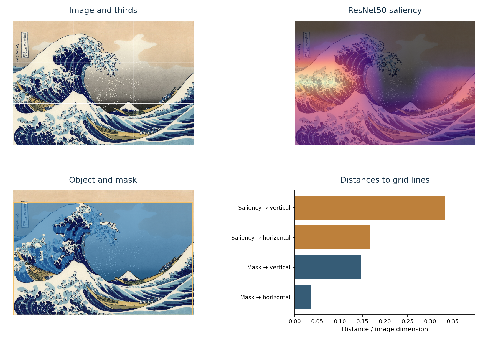

# Rule-of-Thirds Detection with Interpretable Geometric Features

**Locate a subject, measure its relationship to the thirds, and classify the composition with an interpretable model.**

[Paper](https://doi.org/10.1145/3746273.3760202) · [Reproduce the experiments](docs/reproduction.md) · [Feature definitions](docs/features.md) · [Citation](#citation)

Armin Dadras, Tingyu Lin, Robert Sablatnig, and Markus Seidl · **ACM SUMAC 2025**, pp. 69–78



The method combines a saliency map from ResNet50, object proposals from YOLO11s, and a foreground mask from Segment Anything. It describes the resulting geometry with 22 features: distances to grid lines and intersections, positions, and how the object extends across the image. Logistic regression or gradient boosting then predicts whether the composition follows the rule of thirds.

The figure shows an actual run on Hokusai’s *The Great Wave off Kanagawa*, using the illustration supplied with the paper. Its measurements describe this example; they do not establish that the composition follows the rule.

## Reproduce the classification results

The feature tables and fitted classifiers are included. This part runs on a CPU, needs no image downloads, and uses portable CSV and JSON files.

```bash
git clone https://github.com/ADadras/Rule-of-Thirds-Detection-with-Interpretable-Geometric-Features.git
cd Rule-of-Thirds-Detection-with-Interpretable-Geometric-Features
python3.12 -m venv .venv
source .venv/bin/activate
python -m pip install -r requirements-lock.txt
python -m pip install --no-deps .

# Check the bundled files, then reconstruct the original predictions
rot-reproduce verify
rot-reproduce replay --output outputs/replay.json

# Train the selected classifiers again on the recorded training rows
rot-reproduce refit --dataset rotds --output outputs/rotds_refit.json
rot-reproduce refit --dataset kupcp --output outputs/kupcp_refit.json
```

Python 3.12 and scikit-learn 1.6.1 are the tested environment. Replaying the saved classifiers and refitting both selected models reproduce the original test predictions exactly.

| Evaluation | Classifier trained on | Images | Accuracy | Precision | Recall | F1 | MCC |
|---|---|---:|---:|---:|---:|---:|---:|
| RoT-DS test rows | RoT-DS | 728 | 0.7431 | 0.7406 | 0.7548 | 0.7476 | 0.4862 |
| KU-PCP test rows | KU-PCP | 704 | 0.9318 | 0.9837 | 0.7246 | 0.8345 | 0.8075 |
| AVT, external evaluation | RoT-DS | 1,115 | 0.7561 | 0.3365 | 0.3431 | 0.3398 | 0.1902 |

These are the recorded experiments: an 80/20 split of each cleaned feature table, with `random_state=42`, and external evaluation on AVT. The KU-PCP experiment pools the original dataset partitions before making this split. The historical search selected models using test F1, so these results should be interpreted with that selection procedure in mind.

The five recorded RoT-DS validation scores are also reproduced exactly. Their mean is **0.743854**; the test F1 is **0.747638**. The paper’s prose gives 0.748 as the validation mean. [Reproduction notes](docs/reproduction.md) separate these quantities and explain the scope of the checks.

## Extract features from an image

Image processing additionally requires PyTorch, YOLO, SAM, and three pretrained checkpoints. Follow the [image setup](docs/image_pipeline.md), then run:

```bash
rot-reproduce extract path/to/image.jpg \
  --sam-checkpoint checkpoints/sam_vit_h_4b8939.pth \
  --yolo-checkpoint checkpoints/yolo11s.pt \
  --resnet-checkpoint checkpoints/resnet50-0676ba61.pth \
  --device cuda:0 \
  --output outputs/features.json --figure outputs/explanation.png
```

The JSON contains all 22 features. The figure displays the image, saliency map, segmentation, and distances. Empty segmentations or undefined measurements produce an explicit `INCOMPLETE_FEATURES` status. A [batch example](examples/extract_dataset.py) loads the models once and records each image’s status, checksum, and processing time.

The default `historical` geometry preserves the conventions used by the released classifiers. `--mode corrected` uses consistent coordinate axes and counts actual line transitions; classifiers must be refitted before using these changed features. See the [feature definitions](docs/features.md).

All **2,547 evaluation images** were also processed again successfully with the released pipeline. Comparing these new features with the archived tables gives identical predictions for all 704 KU-PCP images; one prediction changes among 728 RoT-DS images and one among 1,115 AVT images. Feature values differ from the archive. The [image-validation report](results/image_validation.json) preserves the measurements, per-image outcomes, runtime, and checksums; [reproduction notes](docs/reproduction.md#new-image-extraction) explain this separate check.

## Included data and models

| Feature table | Rows with all 22 features | Positive labels | Negative labels |
|---|---:|---:|---:|
| RoT-DS | 3,638 | 1,836 | 1,802 |
| KU-PCP | 3,516 | 788 | 2,728 |
| AVT | 1,115 | 204 | 911 |

These are the author’s archived features and labels, with original row identifiers retained. The repository contains **derived features**. Photographs and pretrained neural-network weights must be obtained separately under their respective terms. [Data provenance](data/README.md) identifies the files, source records, and checksums.

## Tests

```bash
python -m pytest
```

The tests verify artifact identity, all recorded test predictions, both classifier refits, the RoT-DS validation folds, and geometric calculations on a rectangular image. [Software validation](docs/software_validation.json) also records a fresh GPU installation and an independent check on images from all three datasets.

## Citation

```bibtex
@inproceedings{dadras2025rule,
  author    = {Dadras, Armin and Lin, Tingyu and Sablatnig, Robert and Seidl, Markus},
  title     = {Rule-of-Thirds Detection with Interpretable Geometric Features},
  booktitle = {Proceedings of the 7th International Workshop on analySis,
               Understanding and proMotion of heritAge Contents},
  series    = {SUMAC '25},
  year      = {2025},
  pages     = {69--78},
  doi       = {10.1145/3746273.3760202}
}
```

## License

The code is available under the [MIT License](LICENSE). Dataset images and pretrained checkpoints retain their respective licenses.
